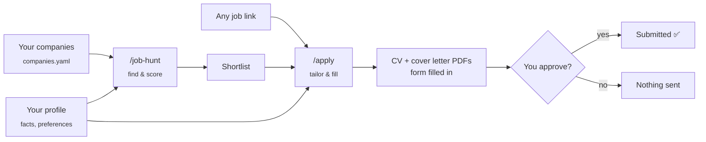

<div align="center">

# jobhunt

**Follow the companies you care about. Get the roles that fit you.<br>Apply with a tailored CV and cover letter, and nothing is sent without your OK.**

[](https://github.com/lnzbati/jobhunt/actions/workflows/ci.yml)


[Quick start](#quick-start) · [Everyday use](#everyday-use) · [Scheduling](#run-it-every-morning) · [Supported sites](#supported-careers-sites) · [Privacy & safety](#privacy-and-safety) · [FAQ](#faq)

</div>

---

## What it does

jobhunt is an assistant for your job search that runs on your own computer inside
[Claude Code](https://claude.com/claude-code). You tell it who you are and which companies
you're interested in. It then:

1. **Checks those companies' careers pages** for new openings. It reads Apple, Google, Meta,
   Microsoft, any company on Greenhouse, Lever or Ashby, and more.
2. **Scores each role against your profile** and keeps a shortlist, with a one-line reason
   for every score.
3. **Writes a CV and cover letter for each role** using only facts you've written down. It
   never invents experience. Each CV is checked the way employers' screening software (ATS)
   reads it: does it parse cleanly, and does it use the job's key terms wherever your
   experience supports them?
4. **Fills in the application form** in your browser and shows you the result.
5. **Submits only when you say so**, one application at a time.

It works with three commands:

| Command | What happens |
|---|---|
| `/job-hunt` | Finds new roles at your companies and builds your shortlist |
| `/apply` | Applies to the roles you pick from your shortlist |
| `/apply <link>` | Applies to one job from any link you paste |

## How it works



Finding roles is done by a small Python tool (`jobhunt`) that talks to the careers sites
directly. It's fast, free, and uses no AI. The judgment calls are done by Claude: which roles
fit, how to present your experience, how to answer the form's questions.

---

## Quick start

### 1. Install what you need

| You need | Why | How |
|---|---|---|
| **Claude Code** | Runs the `/job-hunt` and `/apply` commands | [Install guide](https://docs.claude.com/en/docs/claude-code) |
| **uv** | Installs and runs the Python tool (and Python itself) | `curl -LsSf https://astral.sh/uv/install.sh \| sh` ([other options](https://docs.astral.sh/uv/)) |
| **A browser tool for Claude** | Lets Claude fill in application forms in your browser | [gstack](https://github.com/garrytan/gstack) `/browse`, Claude in Chrome, or a Playwright MCP |

> [!TIP]
> No browser tool? Everything still works except the form filling. You get the finished PDFs
> and drafted answers, and submit them yourself.

### 2. Get jobhunt

```bash
git clone https://github.com/lnzbati/jobhunt.git
cd jobhunt
uv sync --extra pdf                      # installs the tool, plus PDF support
uv run playwright install chromium       # one-off, ~150 MB, used to make the PDFs
```

### 3. Open it in Claude Code and set up your profile

```bash
claude
```

Then type:

```
/job-hunt setup
```

Claude asks for your CV (a file path or pasted text) and a few questions: what roles, where,
whether you need a visa, and so on. From that it writes two private files:

| File | What's in it |
|---|---|
| `profile/master_facts.md` | **Everything you can stand behind**: every job, achievement, number and skill. CVs are built only from this. |
| `profile/profile.yaml` | Contact details, what you're looking for, and standard answers for forms (notice period, work authorisation…) |

Read both and correct anything that's off. They're the foundation for everything else.

### 4. Choose your companies

Tell Claude in plain words, for example *"follow Apple, Monzo and Wayve"*, or use the terminal:

```bash
uv run jobhunt add Apple
uv run jobhunt add Monzo
uv run jobhunt add "Wayve"
```

jobhunt recognises the built-in sites and finds the job board for most other companies
automatically. If it can't, Claude offers to build support for that site
(see [Adding a site](#adding-a-careers-site)).

**You're set up.** Run `/job-hunt` to see what's out there.

---

## Everyday use

### Find and shortlist roles: `/job-hunt`

```
/job-hunt
/job-hunt only platform roles this time
```

Claude checks every company, scores new roles from 0 to 100 against your profile, and shows
your shortlist:

```
Score  Company   Role                                   Location   Why
  86   Acme      Senior Backend Engineer, Payments      London     Payments + Postgres scale match
  78   Globex    Platform Engineer                      Remote EU  Kubernetes, infra ownership
  71   Initech   ML Infrastructure Engineer             London     Good fit, but asks for Rust
```

Roles it decides against are kept with the reason, so they aren't shown again.

### Apply from your shortlist: `/apply`

```
/apply
```

Pick the roles you want. For each one Claude:

1. **Tailors** a CV and cover letter from your facts file and renders them as PDFs. It lists
   the job's key terms first, uses every one your facts support (in the job's own wording), and
   reports the ones you don't have as gaps instead of adding them.
2. **Checks the CV like an ATS would**: it extracts the text from the PDF, confirms your
   name, email, phone, headings and dates come through intact, and measures key-term coverage.
3. **Drafts answers** to the form's questions. It asks you about anything it can't answer
   from your profile, like salary for a new country. It never guesses those.
4. **Fills in the form** in your browser, uploads the PDFs, and takes a screenshot.
5. **Stops and shows you** the CV, the answers, key-term coverage and gaps, and the screenshot.

You reply with what to send, for example *"submit 1 and 3"*. Only those go out.

### Apply to a single job from a link: `/apply <link>`

Found a role somewhere else? Paste the link:

```
/apply https://jobs.ashbyhq.com/acme/0a1b2c3d-4e5f-6789-abcd-ef0123456789
/apply https://careers.example.com/jobs/senior-backend-engineer
```

This works with any careers site. jobhunt reads the posting (most sites publish it in a
standard format), then the same tailor, fill and approve steps follow.

### What you get for each application

Every application gets its own folder in `applications/`, for example
`applications/2026-11-22-acme-senior-backend-engineer/`:

| File | What it is |
|---|---|
| `First-Last-CV.pdf` · `First-Last-Cover-Letter.pdf` | What gets uploaded, named after you because recruiters see the file name. `cv.md` and `cover_letter.md` are the editable sources. |
| `keywords.md` | The job's key terms (must-haves marked `!`) |
| `ats-plan.md` · `ats.md` | Which key terms your facts support, and the check of the finished PDF: parsing, coverage, gaps |
| `jd.md` | The job description, saved in case the posting disappears |
| `questions.md` | The form's actual questions, when the site provides them |
| `answers.md` | The answers given on the form |
| `tailoring.md` | What was emphasised, what was left out, and gaps against the job |
| `pre-submit.png` | Screenshot of the filled-in form before sending |
| `confirmation.txt` | The confirmation after you approved and it was submitted |

---

## Run it every morning

jobhunt can check for new roles on a schedule and leave you a summary:

```bash
uv run jobhunt schedule add --task discover --at 08:30 --days weekdays --notify
```

Each weekday at 08:30 it fetches new roles and writes a digest to `data/digests/<date>.md`,
with a desktop notification. That's free, with no AI involved. Use `--task score` to also
have Claude score them, so your shortlist is ready when you sit down (that uses model usage).

```bash
uv run jobhunt schedule list               # what's scheduled
uv run jobhunt schedule remove discover    # stop it
```

Or just ask: `/job-hunt schedule`.

> [!NOTE]
> Scheduled runs **never apply**. Your computer needs to be awake at that time. Details,
> options and troubleshooting are in **[docs/scheduling.md](docs/scheduling.md)**.

---

## Supported careers sites

| Site | Covers | How it's read |
|---|---|---|
| **Greenhouse** | Thousands of companies (Anthropic, Stripe, Monzo, Waymo…) | Public job-board API |
| **Ashby** | Thousands of companies (Wayve, Notion, Cohere…) | Public job-board API |
| **Lever** | Thousands of companies (Spotify, Palantir…) | Public job-board API |
| **Apple** | jobs.apple.com | Built-in |
| **Google** | Google, DeepMind, YouTube | Built-in |
| **Meta** | metacareers.com | Built-in |
| **Microsoft** | And other sites on Eightfold.ai | Built-in |
| **Any job link** | `/apply <link>` on almost any site | The posting's standard job data, or the page itself |

`uv run jobhunt sources` lists everything available in your copy.

### Adding a careers site

If a company's site isn't covered, ask `/job-hunt add <company>`. Claude offers to build
support for it with [reverse-api-engineer](https://github.com/kalil0321/reverse-api-engineer),
which watches the site load its jobs and writes a small client for it. That costs roughly
1 to 2.50 USD of model usage per site, once.

New sites are **personal by default**. They go in `local_sources/`, which git ignores, so a
company only you follow never ends up in the shared repo. If it's useful to others
(especially a whole platform like Workday), move it to `src/jobhunt/sources/` and open a PR.
The step-by-step guide is in **[docs/adding-a-source.md](docs/adding-a-source.md)**.

---

## Privacy and safety

| | |
|---|---|
| 🔒 **Your data stays local** | Your profile, facts, companies, personal sources, application folders and job database (`profile/`, `companies.yaml`, `local_sources/`, `applications/`, `data/`) are all excluded from git. Nothing personal is ever committed. |
| ✋ **You approve every submission** | Applications can't be withdrawn, so each one waits for your explicit OK for that specific role. |
| 🚫 **No made-up experience** | Every line in a CV or letter must come from your facts file. Gaps are reported, not covered up. |
| 🤖 **Employers' AI policies respected** | If a form asks you to write an answer yourself, Claude leaves it for you. |
| 🧩 **No tricks** | It never solves captchas or gets around logins, and it doesn't touch LinkedIn (automating it gets accounts banned). |
| 🔑 **Your passwords stay yours** | You type passwords and verification codes yourself, in the browser. They're never asked for in chat or saved. |

> [!NOTE]
> When you share your CV with Claude, or Claude reads your files, that content is part of
> your Claude Code conversation. It's not sent anywhere else, and applications go only to the
> employer you approve.

The built-in Apple, Google, Meta and Microsoft readers use the same public job
listings those sites show any visitor, but they aren't official APIs. Keep request rates
low (one check a day is plenty) and expect them to need fixing when a site changes. A
weekly automated check catches that. This project isn't affiliated with any of these companies.

---

## FAQ

<details>
<summary><b>Does it cost anything?</b></summary>

jobhunt itself is free. Finding roles uses no AI. Scoring, tailoring and form filling run in
Claude Code and count towards your Claude plan or API usage, like any other Claude Code work.
Scheduled `discover` runs are free. Scheduled `score` runs use model usage each time.
</details>

<details>
<summary><b>Can it apply to jobs while I'm away?</b></summary>

No, by design. It can find and score roles on a schedule, but every submission needs your
explicit approval. You're the one accountable for what's sent under your name.
</details>

<details>
<summary><b>The roles it finds aren't relevant.</b></summary>

Tune `search` in `profile/profile.yaml`: the search terms for the big sites, the title words
to include or exclude, and your locations. `preferences` controls the scoring. Then run
`/job-hunt` again.
</details>

<details>
<summary><b>A company shows an error when checking for roles.</b></summary>

For the built-in sites (Apple, Google, Meta, Microsoft) it usually means the site
changed. Ask Claude to fix it, or open an issue. The other companies keep working in the
meantime.
</details>

<details>
<summary><b>The site wants me to sign in, or asks one question per screen.</b></summary>

Many big-company portals do this: email → Next → name → Next → a code sent by email… `/apply`
works through them one screen at a time. It fills your email, name and phone from your profile.
**You** type the password and any verification code, and solve captchas, in the same browser
window. It never asks for your password in chat or stores it. It also double-checks answers
the site pre-filled from an earlier application, since those are often out of date.

Make sure Claude's browser is one you can see and type into (for gstack, `/open-gstack-browser`).
</details>

<details>
<summary><b>Can it remember how a particular site works?</b></summary>

Yes. When `/apply` learns something about a site (a redirect to wait out, a button label, a
field that's always pre-filled wrongly), it writes it to `profile/apply-notes.md` and reads it
on every run. The file is private (gitignored). See
[`profile/apply-notes.example.md`](profile/apply-notes.example.md) for the format.
</details>

<details>
<summary><b>What does the ATS check do, and will it stuff keywords into my CV?</b></summary>

Most employers run CVs through an applicant tracking system that extracts the text and
searches it for the job's key terms. jobhunt checks for both problems an ATS can catch: a CV
that doesn't extract cleanly (missing contact details, unusual headings, merged characters
like "fi" that break search), and missing key terms.

It never adds a term your facts don't support. Those are listed as **gaps** in `ats.md` and
`tailoring.md`, for you to address in the cover letter or the interview, and the coverage
figure reflects the truth.
</details>

<details>
<summary><b>Can I edit the CV before it's sent?</b></summary>

Yes. Edit `cv.md` or `cover_letter.md` in the application folder, ask Claude to re-render
(`uv run jobhunt render <folder>`), and approve when you're happy.
</details>

---

## Configuration

<details>
<summary><b>companies.yaml</b>: who to follow</summary>

Created for you by `jobhunt add`. You can also copy [`companies.example.yaml`](companies.example.yaml),
which documents every option, and edit it by hand.

```bash
uv run jobhunt companies                 # list
uv run jobhunt add "<Name>" [--url <careers page>]
uv run jobhunt remove <key>              # or set `enabled: false` to pause
```
</details>

<details>
<summary><b>profile/profile.yaml</b>: what you want and standard answers</summary>

See [`profile/profile.example.yaml`](profile/profile.example.yaml). Its sections:

| Section | Purpose |
|---|---|
| `me` | Name and contact details, used on the CV and in forms |
| `search` | Search terms for big sites, title include/exclude words, locations, remote regions |
| `search.site_filters.<company>` | Location filters for big sites (e.g. Apple's `united-kingdom-GBR`) |
| `preferences` | What Claude scores against: seniority, target roles, must-haves, things to avoid |
| `application` | Answers reused in forms: work authorisation, notice, salary, demographics |
| `apply` | Approval gate and a per-company weekly cap |
</details>

<details>
<summary><b>profile/master_facts.md</b>: the only source of facts</summary>

See [`profile/master_facts.example.md`](profile/master_facts.example.md). List every role,
achievement (with numbers) and skill you can back up in an interview. Add a "Do not mention"
section for anything confidential.
</details>

<details>
<summary><b>profile/apply-notes.md</b>: what it has learned about specific sites</summary>

Optional and created by `/apply` as it goes. It holds notes per careers site (sign-in steps,
button labels, pre-filled fields to re-check), read at the start of every run. See
[`profile/apply-notes.example.md`](profile/apply-notes.example.md).
</details>

<details>
<summary><b>CLI reference</b></summary>

```bash
uv run jobhunt discover [<company> ...]      # fetch new roles (all or some companies)
uv run jobhunt jobs [--status new|shortlisted|drafted|ready|applied|skipped|closed|all]
uv run jobhunt show <uid>                    # one role with its full description
uv run jobhunt import <url>                  # one posting from a link -> application folder
uv run jobhunt prepare <uid>                 # create the application folder for a role
uv run jobhunt render <folder>               # cv.md / cover_letter.md -> PDF (+ First-Last-CV.pdf)
uv run jobhunt ats <folder> --plan           # job's key terms vs your facts: use these / gaps
uv run jobhunt ats <folder>                  # check the rendered CV like an ATS: parsing + coverage
uv run jobhunt status <status> <uid>...      # move roles through the pipeline
uv run jobhunt digest [--write]              # summary: new, shortlisted, waiting for approval
uv run jobhunt schedule add|list|remove      # see docs/scheduling.md
uv run jobhunt add|remove|companies|sources  # manage companies
```

Add `--json` to any command for machine-readable output. A role moves through
`new → shortlisted → drafted → ready → applied` (or `skipped`; roles taken down become `closed`).
</details>

---

## Contributing

New careers sites, fixes and ideas are welcome. Read **[CONTRIBUTING.md](CONTRIBUTING.md)** first.

```bash
uv sync --extra dev
uv run pytest -q                                   # offline tests
JOBHUNT_LIVE=1 uv run pytest -m live -v            # against the real sites
```

## License

[MIT](LICENSE)
